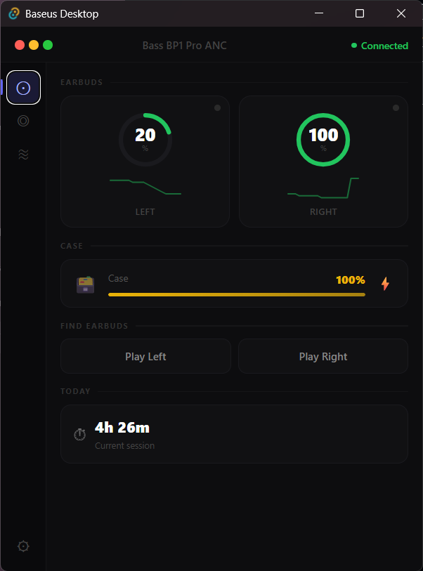

# baseus-desktop

Open-source desktop client for Baseus earbuds, built by reverse-engineering
the official Baseus Android app.

**Platform:** Windows 10 1903+ and Linux (BlueZ 5.6x). The Bluetooth layer is
[btleplug](https://github.com/deviceplug/btleplug), so both backends run the same code;
only the updater is Windows/macOS-only, since Linux installs come from the distro.

## Supported hardware

| Model | Status | Battery | ANC | EQ | Game mode |
|---|---|---|---|---|---|
| Bass BP1 Pro ANC | ✅ Verified | ✅ L/R/case | ✅ 3-mode + strength | ✅ 4 presets | ✅ Low-latency toggle |
| Bass BP1 Ultra | ✅ Verified (fw 1.0.26) | ✅ L/R/case | ✅ 3-mode + 5 levels | ✅ 4 presets | ✅ Low-latency toggle |

The BP1 Ultra has no find-my-earbuds support yet: the official app only offers it to
logged-in accounts, so the command was not captured. The buds may also refuse low-latency
mode (`24 0B`) when LDAC is active — the official app got the same refusal — and the toggle
then falls back to Off. See [docs/protocol/bp1-ultra.md](docs/protocol/bp1-ultra.md).

Only hardware-verified models are supported. Earlier drafts included Inspire XH1/XP1/XC1
support extracted from the Baseus Android APK, but since none was ever confirmed on a real
device it has been removed rather than ship promises we can't back.

**Own a different Baseus model?** Adding it is the goal — see
[docs/re-methodology.md](docs/re-methodology.md) for how to capture your device's protocol
and contribute it back. Protocol capture tooling to make this much easier is on the roadmap.

## Features

- Live L / R / case battery with charge state indicators
- Session timer (time since buds connected)
- ANC mode switching (Off / Active Noise Cancellation / Transparency) with strength slider
- Game / low-latency mode toggle
- EQ preset selection (Balanced / Bass Boost / Voice / Clear)
- Find-my-buds (plays a tone on one earbud)
- Low-battery desktop notifications
- Launch at login



## Troubleshooting

- **The app opens and nothing happens.** On a manual launch it opens its window; with
  *Launch at login* it starts in the tray. Closing the window also leaves it in the tray.
  Use the tray icon to bring it back, or its menu's **Quit** to exit.
- **Stuck searching.** While disconnected, the home tab says why the last attempt failed.
  The earbuds accept one control connection at a time, so close the Baseus app on your
  phone. In dual-device mode, the other device may be holding that connection.
- **"Unsupported earbuds found".** Your model is visible but not supported yet. See
  [docs/re-methodology.md](docs/re-methodology.md) to help add it.

## Building

```
# Prerequisites: Rust stable, Node.js, pnpm
pnpm install
pnpm tauri build
```

Or for development with hot-reload:

```
pnpm tauri dev
```

### Linux

Install the Tauri and BlueZ prerequisites first — on Arch:

```
sudo pacman -S --needed rustup webkit2gtk-4.1 patchelf bluez bluez-utils
```

Debian/Ubuntu equivalents are `libwebkit2gtk-4.1-dev`, `build-essential`, `patchelf`,
`libssl-dev`, `libayatana-appindicator3-dev`, `librsvg2-dev` and `bluez`.

`pnpm tauri build` emits a `.deb`/`.rpm`/AppImage. To skip the bundler and just get a
binary:

```
pnpm build   # the embedded frontend must exist first
cargo build --release -p baseus-app --features custom-protocol
```

`--features custom-protocol` is not optional. `tauri` derives `cfg(dev)` from its
absence, so a binary built without it ignores the embedded frontend and tries to load
`build.devUrl` — the window opens showing
`Could not connect to localhost: Connection refused`. The Tauri CLI passes the feature
for you; a bare `cargo build` does not.

To verify the Bluetooth path without the GUI:

```
cargo run -p baseus-transport --example connect -- anc:on anc:off
```

The example detects the model from the first notification and encodes the commands for
it. On the BP1 Ultra, `anc:?` also queries the current noise-control state.

**Note on discovery:** these earbuds put their service UUID in the BLE *scan response*,
not in the advertisement. A `ScanFilter` with service UUIDs becomes a BlueZ discovery
filter that matches the advertisement only, so filtering hides the device completely —
the scan is deliberately unfiltered and the match happens afterwards. The advertised
name is unreliable on BlueZ for the same reason (`local_name` is frequently `None`),
which is why the service UUID is the primary match key.

The buds also stop advertising after a while. If the app cannot find them, open the
charging case to make them advertise again.

The BP1 Ultra only advertises its control service while no other app holds a control
session: close the official Baseus app on your phone (it connects over Classic SPP) or the
desktop app will not find the buds.

## Protocol documentation

The reverse-engineering methodology and full packet tables live in [`docs/protocol/`](docs/protocol/).
Frida hook scripts used to capture BLE writes are in [`docs/frida/`](docs/frida/).

See [`docs/re-methodology.md`](docs/re-methodology.md) to add support for a new Baseus model —
each model is one file in `crates/baseus-protocol/src/models/`.

## Architecture

```
baseus_rebuild/
├── crates/
│   ├── baseus-protocol/   # Pure Rust: packet framing, types, per-model decoders
│   └── baseus-transport/  # WinRT BLE GATT transport
├── apps/
│   └── baseus-app/        # Tauri shell + SolidJS frontend
└── docs/
    ├── protocol/          # Packet tables and framing docs
    └── frida/             # BLE capture scripts
```

## Disclaimer

This project is not affiliated with or endorsed by Baseus. All trademarks belong to their respective owners.

## License

MIT
